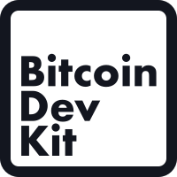

# 

  

 

The Bitcoin Dev Kit (BDK) is a suite of software libraries that allow you to build secure, feature-rich, and cross-platform bitcoin-based applications.

Start building with the [Book of BDK](https://bookofbdk.com/), which includes tutorials, runnable examples, and links to the library APIs.
